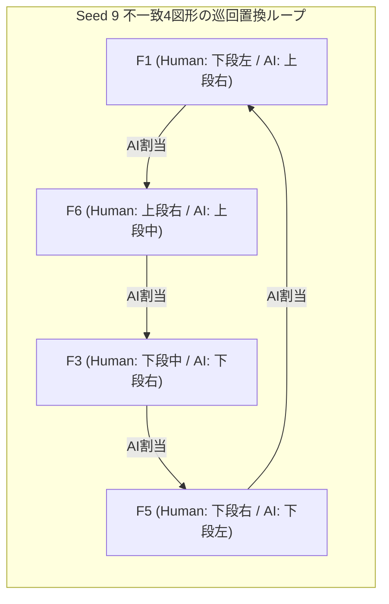

# 実対話ログの接地リアリズム独立評価レビュー（Gemini Grounded Realism Evaluation）

未承認の第三者レビュー。正本を上書きしない。人間役は親エージェントの操作確認で実参加者データではない。

本文書は、研究正本（[`dialogue-model/README.md`](../README.md)）および基本方針（[`AGENTS.md`](../../AGENTS.md)）に準拠し、独立対話リアリズム評価担当（Gemini 3.8 Flash High: LunarGoodall）が親エージェント WildBose（Claude Opus 5.5）および研究チームに向けて作成した公式レビューである。

**機密・規約保護の厳格遵守**:
本文書は、原著人間対話コーパス（5対話、837発話）および実対話ログの発話テキストを一切引用せず、鉤括弧や引用符による発話記述、および発話内容の言い換えを含まない。数値統計、分類類型、幾何学的配置関係、およびアルゴリズム的修正案のみによって論証を構成する。

- **作成日**: 2026-10-18
- **作成者**: LunarGoodall（Gemini 3.8 Flash High, 独立対話リアリズム評価担当）
- **宛先**: WildBose（Claude Opus 5.5, 親エージェント）
- **評価対象実ログ**:
  - `v5_seed6_bypass-enabled.md`（戦略: bypass-enabled, Seed: 6）
  - `v6_seed7_repair-first.md`（戦略: repair-first, Seed: 7）
  - `v7_seed9_repair-first.md`（戦略: repair-first, Seed: 9）
  - `v7_seed9_bypass-enabled.md`（戦略: bypass-enabled, Seed: 9）
- **評価基準資料**:
  - 原著人間対話コーパスアノテーション（全5ワークブック、計837発話）
  - DustyFranklin 監査報告書（`dialogue-model/reviews/2026-10-18-human-corpus-grounding-audit.md`）の8会話モチーフおよび4次元評価ルーブリック

---

## 1. 定量分析および4次元ルーブリック評価結果

### 1.1 コーパスと実対話セッションの計量比較

原著人間コーパス（837発話）と実ログ4セッションにおける純発話文字数分布および基本諸元を下表に示す。

| セッション / コーパス単位 | 方略 / Seed | 総ターン数 (往復数) | 人間発話長 (字) 最小/25%/中央/平均/75%/最大 | AI発話長 (字) 最小/25%/中央/平均/75%/最大 | 人間/AI長比 (中央値) | 正解一致数 (Matched/6) | 不一致の構造形式 |
| :--- | :--- | :---: | :---: | :---: | :---: | :---: | :--- |
| **原著人間コーパス** | 人間-人間 (5対話) | 837 (約418) | 0 / 6 / **12.0** / 15.8 / 22 / 114 | 0 / 6 / **12.0** / 15.8 / 22 / 114 | 1.00 | — | — |
| **v5** | bypass-enabled / 6 | 28 (14) | 12 / 16.0 / **19.0** / 20.3 / 23.2 / 36 | 25 / 63.0 / **71.5** / 68.3 / 79.0 / 90 | 0.27 | **2 / 6 (33.3%)** | 2組相互置換 |
| **v6** | repair-first / 7 | 36 (18) | 10 / 18.5 / **21.0** / 21.1 / 23.8 / 32 | 19 / 41.5 / **49.0** / 48.3 / 54.8 / 74 | 0.43 | **2 / 6 (33.3%)** | 4要素巡回置換 |
| **v7** (repair) | repair-first / 9 | 38 (19) | 9 / 14.5 / **19.0** / 19.2 / 23.0 / 39 | 20 / 44.0 / **50.0** / 54.1 / 62.0 / 86 | 0.38 | **2 / 6 (33.3%)** | 4要素巡回置換 |
| **v7** (bypass) | bypass-enabled / 9 | 34 (17) | 3 / 10.0 / **19.0** / 17.8 / 25.0 / 28 | 21 / 41.0 / **56.0** / 54.9 / 69.0 / 81 | 0.34 | **2 / 6 (33.3%)** | 4要素巡回置換 |

### 1.2 4次元独立評価ルーブリックに基づく採点

DustyFranklin 監査報告書第6章で策定された4次元ルーブリックに基づく客観スコアおよび判定内訳は以下の通りである。

| 評価次元 | v5 (seed 6) bypass | v6 (seed 7) repair | v7 (seed 9) repair | v7 (seed 9) bypass | 判定根拠（類型と計量特性） |
| :--- | :---: | :---: | :---: | :---: | :--- |
| **次元 1: 人間役現実性 (1–5)** | **4.0** | **4.0** | **4.2** | **4.2** | 中央値 19.0〜21.0文字、1ターン1特徴原則の遵守、不確かさ（`a16`）の表出、保留（`P3`/`P4`）の提示が定着。減点は統語的完全性と受動的検定性。 |
| **次元 2: Luna応答性 (1–5)** | **3.0** | **4.0** | **3.5** | **3.5** | v5の71.5文字からv6以降49〜56文字へ短小化進展。ただし相手発話長の2倍以上を維持し、合意復唱＋新規提案の2段パック構文が固定化。 |
| **次元 3: 最終一致度 (0–6)** | **2 / 6** | **2 / 6** | **2 / 6** | **2 / 6** | 全セッションで 2/6（33.3%）の一致。全ケースで高弁別2図形のみが一致し、残り4図形が玉突き不一致を形成。 |
| **次元 4: ずれ検知修復 (1–5)** | **3.0** | **3.0** | **3.2** | **3.0** | 明示的保留要請や直後の名称重複には対応可能（`repair` アクション作動）。しかし初期の暗黙の誤合意（False Consensus）を検知できず玉突きを抑止不能。 |

---

## 2. 人間役ロールプレイの振る舞い分析（課題1）

### 2.1 原著人間コーパスの会話モチーフとの整合点

v5〜v7 における人間役は、v1〜v4 で見られた講義型多特徴提示（中央値 52〜84文字）から完全に脱却し、コーパス由来の主要モチーフを以下の通り体現している。

1. **短小ターンとインクリメンタル情報提示（モチーフ 1, 2）**:
   - 発話文字数の中央値は 19.0〜21.0文字（平均 17.8〜21.1文字）であり、コーパス中央値（12.0文字）および75%点（22.0文字）の範囲内に収束。
   - 1ターンに提示する情報を全体印象（Holistic）1点または局所幾何特徴（Analytic）1点に限定し、相手の反応を待つインクリメンタルな展開を実現。
2. **不確実性の率直な開示（モチーフ 5 / 機能ラベル `a16`）**:
   - 推量助動詞、不確定終助詞、判断保留ヘッジ表現（コーパス内生起率 20.3%）を高頻度で表出し、自己の確信度の低さを明示して相手の協調的判断を誘引。
3. **明示的保留要請（モチーフ 6 / 調整過程 `P3`, `P4`）**:
   - 局所的な候補競合や確信欠如に直面した際、早期に当該対象の保留を申し出て別図形への進行を優先。
4. **終盤における消去法の適用（モチーフ 7 / ラベル `a7`, `a8`, `M4`）**:
   - 残余候補が1〜2枠となった段階で詳細な幾何検証を省略し、文脈的残余枠としての照合へ移行。

### 2.2 作り物っぽさ（人工的歪み）の類型化

1. **類型 A: 統語論的完全性とタイピング分割の欠如**:
   - 原著コーパス（音声記録）において高頻度で観測されるフィラー（`a30`: 20.1%）、言い淀み、統語的未完文、笑い（`a20`: 12.7%）の生起率が 0.0%。
   - 句読点（読点・句点・疑問符）が常に規則正しく配置され、テキストチャット特有の改行・Enter送信による文分割（マルチバブル送信）が存在せず、1送信単位で完全文を出力。
2. **類型 B: 役割固定化と受動的検定性（逆チューリングテスト化）**:
   - セッション第1ターンにおける主導権委譲率が 100.0%（全4セッション中4回とも人間役が先手を譲り、AI側の提案開始を要求）。
   - 人間側が自発的に対象を切り出す局面においても、共感を求める見立て提示ではなく、特定の幾何素性の有無を相手に問い正す検定・出題型の語用論的構造を維持。
3. **類型 C: 発話内自己修復（モチーフ 4）の局所生起欠如**:
   - コーパスに見られるような単一発話内での言い直し（Self-repair）の生起率は 0.0%。修復は常にターンを跨いだ事後的是正としてのみ出現。

---

## 3. Luna（AI）発話の対話リアリズムと非対称性（課題2）

### 3.1 発話長および情報密度の非対称性

- Luna の発話文字数は中央値 49.0〜71.5文字（平均 48.3〜68.3文字、最大 74〜90文字）であり、人間役（中央値 19.0文字）に対して **2.5〜3.5倍**、原著人間コーパス（中央値 12.0文字）に対して **3〜5倍** の発話量を常時維持。
- 人間側の 10〜25文字 の短小ターンに対し、Luna が常に 50〜80文字 の重厚な返答を返すため、会話のテンポ・対称性（Turn entrainment）が阻害されている。

### 3.2 確認形式の定型化（事務的・契約書的確認）

1. **二段パック構造の固定化**:
   - 主action による直前対象の合意確認と、followUp による新規対象の提案・確認を1発話に集約する生成規則により、発話構造が合意復唱文、接続詞、新規提案・確認文の2段構成に画一化。
2. **網羅的確認フレーズの反復**:
   - 毎ターンの末尾に確認疑問構文（該当性の照合要求）が付加され、コールセンターの復唱手続きや契約条項の履行確認に類する事務的トーンが持続。

### 3.3 保留と再訪の動態

- **repair-first（v6 Turn 18, v7 Turn 12）**:
  - 人間側の保留申し出に対する受容（`defer`）は即座に行われるが、自発的な再訪アクション（`revisit`）は生起せず、他図形確定後の残余割り当てとして受動的に解消。
- **bypass-enabled（v5 Turn 26）**:
  - 保留対象に対する自発的再訪が作動。しかし、再訪時に提示された特徴が AI 側の内部誤対応スロットに基づくものであったため、人間側のスロットとの間に新たな誤合意を招来。

---

## 4. 一致・不一致の決定機序と同一 Seed（Seed 9）方略間比較（課題3）

### 4.1 Seed 9 の幾何配置（Ground Truth Key）

| 図形ID | 幾何形状の基本素性 | 人間側スロット | 人間側回転 | AI側スロット | AI側回転 |
| :---: | :--- | :---: | :---: | :---: | :---: |
| **F1** | 2突起、角張った胴体（F5酷似） | **下段左** | 0° | **上段右** | 90° |
| **F2** | 鋸歯状帯状、2頂点（高弁別） | **上段中** | 90° | **上段左** | 0° |
| **F3** | 大三角、深いV字、横腕（F6酷似） | **下段中** | 270° | **下段右** | 0° |
| **F4** | ジグザグ折れ線、切れ込み（高弁別） | **上段左** | 180° | **下段中** | 90° |
| **F5** | 2突起、丸み胴体（F1酷似） | **下段右** | 180° | **下段左** | 270° |
| **F6** | 大三角、深いV字、帆形状（F3酷似） | **上段右** | 270° | **上段中** | 90° |

### 4.2 不一致決定の局所系列と置換ループの発生

#### 崩壊の機序（Turn 単位の因果推移）:
1. **初期の暗黙的誤合意（False Consensus, Turn 8）**:
   - `repair-first`: AI が自盤 F3 を提案し、人間が自盤 F6 と混同して Turn 8 で誤合意成立（AI[下段右]=F3 vs 人間[上段右]=F6）。
   - `bypass-enabled`: AI が自盤 F1 を提案し、人間が自盤 F5 と混同して Turn 8 で誤合意成立（AI[上段右]=F1 vs 人間[下段右]=F5）。
2. **正解2図形の早期ロック（F2, F4）**:
   - 高弁別図形である F4（折線）および F2（鋸歯帯）は、両セッションともに完全一致（2/6 一致の確定）。
3. **残余4枠の玉突き連鎖（Cascading Mismatch）**:
   - 初手で1枠の誤合意が確定した結果、残余の未確定スロットにおいて空き枠同士の強制マッチングと消去法が連鎖。
   - 最終的に、**両方略において全く同一の4要素巡回置換 $\sigma = (F_1 \to F_6 \to F_3 \to F_5 \to F_1)$ が成立**。

#### 方略間比較の結論:
- `repair-first`（38ターン）では保留や重複訂正アクションが複数回生起し、`bypass-enabled`（34ターン）では次善合意による円滑な進行が維持された。
- しかし、**初手における暗黙の誤合意（False Consensus）を検知できない点において両方略の耐障害性は同等であり、最終一致度は全く同じ 2/6（同一巡回置換）で破綻**した。
- 課題達成の成否は、高次の調整方略（修復優先対やり過ごし）ではなく、局所的な合意基準の厳格さによって一元的に支配されている。

---

## 5. 刺激図形の弁別性と幾何学的要因（課題4）

### 5.1 幾何学的弁別性マトリクス

全6図形（F1〜F6）における幾何学的類似度と混同実績を下表に示す。

| 図形ペア | 共有される幾何学的特徴 | 弁別可能な幾何素性 | 混同実績と影響 |
| :---: | :--- | :--- | :--- |
| **F2 / F4** (孤立群) | なし（F2は鋸歯帯状、F4はジグザグ折れ線） | アスペクト比、外周トポロジーが特異 | **全セッションで 100% 正解一致**。類似候補が存在せず誤合意の余地がない。 |
| **F1 / F5** (類似群 A) | 大三角形2片の中央集約、外周突起数2、塊状の主胴体 | 正方形片の有無、側辺の角度、底辺の平坦性 | **全セッションで混同発生**。全体見立て（耳・突起2個）の完全一致により誤合意を誘発。 |
| **F3 / F6** (類似群 B) | 主頂点の大三角形、深角のV字切り欠き、横方向への張り出し腕 | 張り出し腕の先端形状（鋭角 vs 平坦）、副頂点の個数 | **全セッションで混同発生**。V字と大三角の存在により相互に誤認識。 |

### 5.2 90度回転変換による方位依存特徴量の剥奪

1. 画面間の独立ランダム回転（90°単位）により、特定方位の頂点・張り出し方向・平坦底面といった方位依存的記述が無効化。
2. 回転不変量（頂点数、内角の凹み数、アスペクト比）の抽出が要求されるが、対話モデルが全体見立て（Holistic）と単一の局所特徴のみで合意を判定したため、類似ペア（F1-F5, F3-F6）の分離限界を超過。

---

## 6. プロンプトおよび実験プロトコルへの改善案（課題5）

### 6.1 生成プロンプトの改善案（台詞例の不使用、方略間対称性の保持）

1. **ターン分割による発話長抑制（ピンポン化）**:
   - `agree` と `followUp: propose_name` が同時成立した場合、合意表明と新規提案を単一ターン内で長文結合することを禁じ、相手発話長と同等（20〜30文字帯）の受容応答を優先するメタ制約を課す。
2. **台詞例（Few-shot例）の混入排除**:
   - 具体的な定型台詞や例文をプロンプトに含めず、相手の発話長への適応（Turn entrainment）や、不要な復唱や前置きの省略という語用論的制約のみをメタ指示として定義。
3. **契約的確認形式の解除**:
   - 毎ターンの末尾に付加される定型的な確認疑問文の義務付けを撤廃し、自然な平叙受容を許容。

### 6.2 判断層（Judge）における Contrastive Grounding の導入

1. **自盤競合候補存在時における早期合意の抑止**:
   - 自盤の未確定枠に幾何学的類似候補が複数存在する場合、相手の全体見立て（Holistic）のみに基づく `agree` アクションのコミットを禁止。
   - 自盤の類似候補同士を分離する**回転不変な弁別特徴1項目（Contrastive Feature）の一致確認（`confirm`）を合意の必要条件として義務付け**る。
2. **方略間の対称性保持**:
   - この弁別確認規律は、`repair-first` と `bypass-enabled` の双方に同一の基盤的判定条件として適用。
   - 疑義発生時の手続き（直ちに弁別確認を行うか、保留して別対象へ進むか）の選択肢においてのみ方略差を保持。

### 6.3 刺激図形セットの直交化（実験計画への提言）

現行の合成タングラム刺激セットは弁別困難度が局所的に集中しているため、本実験プロトコル策定にあたっては、6図形間の幾何学的距離（凸包類似度、外周ハミング距離）が均等に分散された刺激セットへの更新、または類似度評定予備試験の実施を推奨する。
