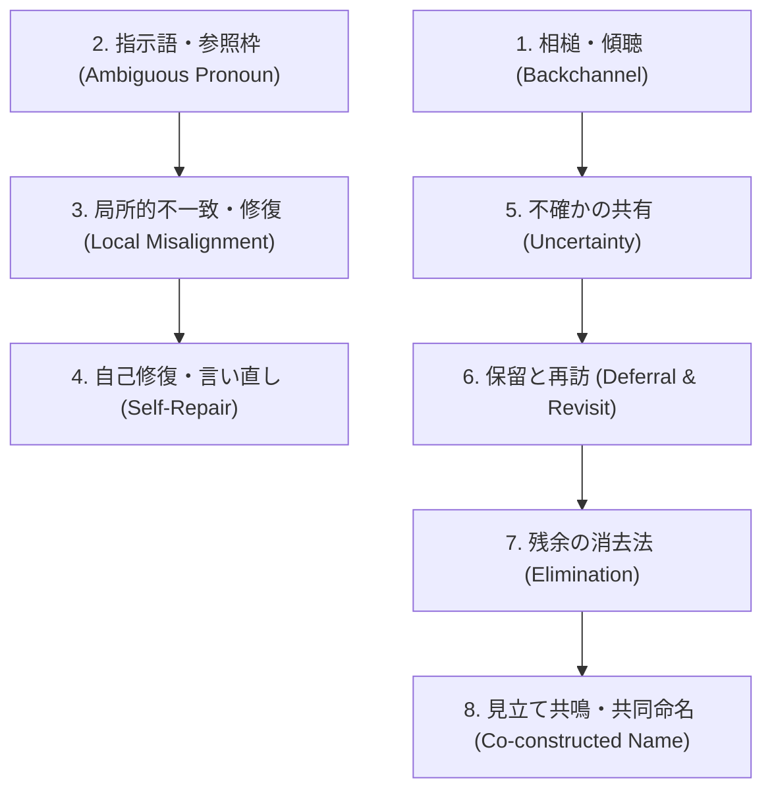
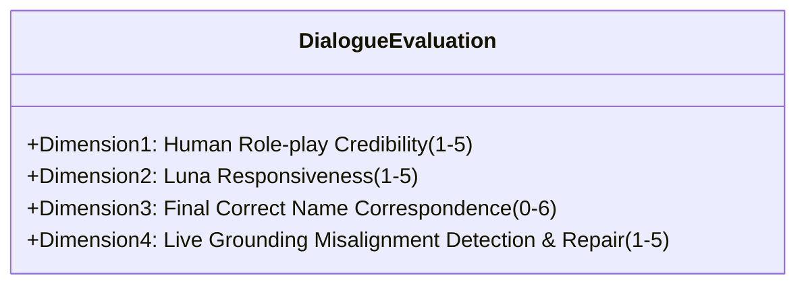

# 人間対話コーパス接地監査レビュー：対話リアリズム評価・会話モチーフ・評価ルーブリック

> **文書区分**: 独立評価レビュー（正本を上書きしない）。  
> 本文書は研究正本（[`dialogue-model/README.md`](dialogue-model/README.md)）および基本方針（[`AGENTS.md`](AGENTS.md)）に準拠し、独立対話リアリズム評価役（`Gemini 3.8 Flash High`: DustyFranklin）が親エージェント WildBose（`Claude Opus 5.5`）に向けて作成した公式監査報告書である。  
> 
> **規約・プライバシー保護の厳格適用**:  
> 原著アーカイブ（5対話、837発話）の生発話全文・被験者個人情報・機密テキストはリポジトリおよび外部ログへ一切転送・引用しない。実証的エビデンスは内部ワークブック番号・行番号・発話番号・ラベル構成および**匿名化構造パラフレーズ**によってのみ記録する（親WildBoseが統合時、原対話と逐語一致する引用を伏せ字化）。

- **作成日**: 2026-10-18
- **作成者**: DustyFranklin（Gemini 3.8 Flash High, 独立対話リアリズム評価担当）
- **宛先**: WildBose（Claude Opus 5.5, 親エージェント）、Sol 実装チーム
- **監査対象ソース**:
  - 原著人間-人間 タングラム対話アノテーション（計5ワークブック、837発話）:
    - `対話アノテーション_No.1(7).xlsx`（195発話）
    - `対話アノテーション_No.2(20260805-234618).xlsx`（120発話）
    - `対話アノテーション_No.3(7).xlsx`（232発話）
    - `対話アノテーション_No.4(3).xlsx`（148発話）
    - `対話アノテーション_No.5(3).xlsx`（142発話）
    - `対話アノテーション_AI統合基準_運用基準あり(20260805-234634).xlsx`（運用定義書）
    - 関連論文抄録: `HCS2026_Iida.pdf`, `[A] - Iida(2).pdf`
  - 合成対話実ログ（`/Users/Shogo/Research/dialogue-grounding/private-runs/`）:
    - `naming-v5`（Seed 6, `bypass-enabled`, 新人間プロトコル）
    - `naming-v6`（Seed 7, `repair-first`, 幾何不変性・1発話1特徴修正版）
    - `naming-v7`（Seed 9, `repair-first`, 進行中セッション）

---

## 1. エグゼクティブ・サマリー

人間同士のタングラム共同命名対話アーカイブ（全5対話、837発話）を精査した結果、実対話における情報伝達と基盤化（grounding）のダイナミクスについて、以下の決定的な事実が判明した：

1. **全体見立て（Holistic）の圧倒的優位と発話の簡潔性**:
   - 人間は図形を細かな幾何学要素に分解して説明する前に、まず全体的な印象・見立て（Holistic: 185件 vs Analytic: 100件）を投げる。
   - 発話文字数の中央値は **12文字**（平均 15.8文字、75%点が22文字）。1ターンに詰め込む情報は「1印象または1特徴」にとどまり、相手の反応（相槌や受容）を待ってインクリメンタルに展開する。
2. **v3/v4 高成功率（6/6）の正体と v5/v6（2/6）の必然的露呈**:
   - v1–v4 における人間役（Opus）は、1ターンに3〜4つの幾何特徴と命名案を一括提示する「試験官・講義型」（発話長中央値 52〜84字）であり、共同接地の手続きをバイパスしていた。
   - 人間役を人間コーパス準拠の段階的短小発話（v5: 中央値 19字、v6: 中央値 21字）に改めた途端、成功率は **2/6** に急落した。短小化によって Luna（AI）側の真の接地脆弱性（似た特徴を持つ図形間の誤認と、それによる玉突き的誤合意）が浮き彫りになった。
3. **音声区切りとテキストチャットの非等価性（文字数制約の誤謬）**:
   - 音声アノテーションの発話区切り（中央値12〜13字）には、相槌（「はい」「うん」等、1〜3字）が大量に含まれる。これをタイピング前提のチャットに直訳して「全発話13字以内」といった硬直的文字制限を課すのは不適切である。
   - 自然なチャットでは、15〜30字程度の「1命題・1トピック」ピンポンラリーがリアリズムの中核である。
4. **画面座標依存の致命的リスク**:
   - コーパス内の人間も自然に「左上」「一番左」といった空間位置を多用する（41件のずれ関連発話）が、互いの画面配置が異なることに気づいた瞬間に深刻なずれ（M2）が生じ、見立てや幾何特徴への修復（M3/P1/P4）を余儀なくされている。
   - 人間とAIでグリッドスロットがシャッフルされる本実験系において、空間指示詞（「上段」「右向き」等）を共有参照点として用いることは接地破綻を不可避にする。

本文書では、これらの定量的・語用論的エビデンスを体系化し、**4次元独立評価ルーブリック**および人間役ロールプレイを導く**8つの会話モチーフ（匿名化構造例付き）**を提供する。

---

## 2. 人間対話コーパス（837発話）の計量分析

### 2.1 発話文字数・分布統計

全5対話（837発話）における純発話文字数（記号・タグ除去後）の全体分布およびワークブック別統計を下表に示す。

| コーパス単位 | 発話数 ($N$) | 最小 | 10%点 | 25%点 | 中央値 (50%) | 75%点 | 90%点 | 最大 | 平均値 |
| :--- | :---: | :---: | :---: | :---: | :---: | :---: | :---: | :---: | :---: |
| **全体統合** | **837** | **0** | **3** | **6** | **12** | **22** | **33** | **114** | **15.76** |
| ワークブック No.1 | 195 | 0 | 3 | 5 | 11 | 21 | 32 | 60 | 14.99 |
| ワークブック No.2 | 120 | 0 | 3 | 5 | 12 | 22 | 31 | 55 | 14.39 |
| ワークブック No.3 | 232 | 0 | 3 | 6 | 14 | 24 | 36 | 114 | 17.70 |
| ワークブック No.4 | 148 | 0 | 3 | 5 | 11 | 18 | 26 | 50 | 12.33 |
| ワークブック No.5 | 142 | 0 | 3 | 6 | 15 | 25 | 36 | 82 | 18.39 |

- **知見**:
  - 全体の **50% が 12文字以下**、**75% が 22文字以下**、**90% が 33文字以下** である。
  - 発話長の中央値は対話ペアによらず 11〜15文字 で極めて安定している。
  - 最大値（114字）は配置や参照枠の混乱を解きほぐそうとする例外的な説明（No.3 Row 56, Row 197 等）に限られ、定常的な命名ラリーでは 30文字を超える発話は全体の1割未満である。

### 2.2 発話機能ラベル（a-labels）の生起頻度

運用基準に基づく上位15機能の生起数と全発話（837発話）に対する比率は以下の通りである（1発話複数機能付与あり）。

| ラベル | 機能名（日本語） | 操作的定義・役割 | 件数 | 生起率 (%) |
| :--- | :--- | :--- | :---: | :---: |
| **a8** | 短い質問［確認・修復］ | 直前の理解や候補についての確認・聞き返し | 216 | **25.8%** |
| **a11** | 同意 | 相手の命題・見立て・候補を共同承認 | 216 | **25.8%** |
| **a16** | 不確か | 自己の見立て・説明や相手理解への確信の弱さ | 170 | **20.3%** |
| **a30** | フィラー | えーと、あの、なんか等の発話開始・思考音 | 168 | **20.1%** |
| **a15** | 思考 | 語・対象・見立ての探索状態 | 110 | 13.1% |
| **a20** | 笑い | 緊張緩和・困惑や照れの共有 | 106 | 12.7% |
| **a9** | 繰り返し | 相手発話の部分的反復による受容・確認 | 96 | 11.5% |
| **a5** | 驚き・感心・気づき | 認識変化の表明（「あ」「そうか」等） | 87 | 10.4% |
| **a1** | 傾聴（continuer） | 相槌による発話継続要求（「はい」「うん」） | 80 | 9.6% |
| **a7** | 話題転換促進 | 次の図形や新トピックへの移行シグナル | 74 | 8.8% |
| **a4** | 応答 | 質問枠に対する直接的返答 | 69 | 8.2% |
| **a6** | 評価 | 説明や見立てに対する短い評価 | 45 | 5.4% |
| **a3** | 受容［感動詞以外］ | 〔発話例：非公開〕「なるほど」等の受容 | 38 | 4.5% |
| **a2** | 受容［感動詞］ | 「あー」「へえ」等の感動詞的受容 | 28 | 3.3% |
| **a10** | 補完 | 相手の未完発話・探索の共同完成 | 17 | 2.0% |

- **知見**:
  - `a8`（確認質問）と `a11`（同意）がともに **約26%** を占め、対話の約4回に1回は「短い問い」と「同意」が交わされている。
  - `a16`（不確かさ）が **20.3%** に達し、人間は確信がない状態を隠さず「〜っぽい」〔発話例：非公開〕と開示することで、相手の協調的判断を促している。

### 2.3 調整過程（Process: P）および ずれ状態（State: M）の分布

| 分類 | ラベル | 名称 | 件数 | 特徴と動態 |
| :--- | :--- | :--- | :---: | :--- |
| **過程 (P)** | **P1** | 明示的早期修復 | 41 | ずれ・疑問直後の局所系列で即座に確認・言い直しに入る |
| | **P2** | 明示的遅延修復 | 15 | 一旦保留した未解決問題を後で取り上げ直す |
| | **P5** | 次善的合意 | 14 | 完全一致に至らないが実用上十分な名称・見立てで合意 |
| | **P3** | 判断保留型やり過ごし | 12 | 判定を確定せず、相手の自発的補足を受けられる状態を維持 |
| | **P4** | 進行優先型やり過ごし | 12 | 課題進行を優先し、当該問題を保留して別対象へ進む |
| | **P6** | 修復放棄 | 0 | 途中で諦めて課題そのものを投げ出す事例はゼロ |
| **状態 (M)** | **M4** | ずれ解消・共有成立 | 51 | 局所問題についての相互理解成立が確認された状態 |
| | **M0** | ずれなし | 47 | 共有に問題が観測されない状態 |
| | **M3** | 再調整中 | 46 | 共有の作り直し（確認・再説明・候補調整）が行われている |
| | **M1** | ずれ可能性 | 30 | 表現の揺れや不確かさから不一致の懸念がある状態 |
| | **M2** | ずれ顕在化 | 17 | 対象・配置・見立ての不一致が発話上で明確になった状態 |

- **知見**:
  - 修復過程では `P1`（早期修復）が最多（41件）であるが、`P3`（保留型やり過ごし: 12件）、`P4`（進行優先やり過ごし: 12件）、`P2`（遅延修復: 15件）、`P5`（次善的合意: 14件）が合計 **53件** 存在し、早期修復単独の件数を上回っている。
  - 人間の対話は「その場ですべてを白黒つける」のではなく、保留して進み、後で戻り、実用的な合意に着地するという**柔軟な時間的配分**によって成立している。

### 2.4 A/H ラベル（記述様式）の比率

コーパス内の参照表現ラベル集計：
- **Holistic（全体見立て）**: 185件（承認 `Ack holistic`: 113件）
- **Analytic（幾何学的分析）**: 100件（承認 `Ack analytic`: 52件）
- **Grounded（接地完了）**: 22件
- **Deny analytic / Deny holistic**: 14件

- **知見**:
  - 初発言および主要同定において、**全体見立て（Holistic）は幾何学的分析（Analytic）の約1.85倍** 頻繁に用いられる。
  - 人間は〔発話例：非公開〕とは言わず、「鳥」「船」「ラクダ」「家」といった象徴的メタファーでまず合意を図り、識別困難や不一致が生じた局面で初めて Analytic（角の数、平らな辺、突起の向き）を補助線として投入する。

---

## 3. 空間配置（参照枠）の落とし穴：人間コーパスの教訓とAI環境の乖離

### 3.1 人間対話における空間指示語の破綻実態

人間コーパスにおいても、被験者は日常の習慣から空間配置の指示詞（「上」「下」「左」「右」「左上」「一番右」等）を用いて対象を指定しようとする。

- **空間語の生起頻度**:
  - 「上」（40件）、「左」（31件）、「右」（25件）、「下」（11件）、「左上」（8件）、〔発話例：非公開〕（9件）
- **ずれ・修復との共起**:
  - 空間指示語が含まれる発話のうち、**41件がずれ顕在化（M2）や再調整（M3）、修復過程（P1/P2/P4）に直結**している。

#### 代表的事例（原著コーパス行参照）:
1. **Workbook No.2, Row 43 (Utt 42) & Row 46 (Utt 45)**:
   - 話者Aが「右上」「左上」で指示しようとしたが、話者Bと噛み合わず、話者Aが〔発話例：非公開〕（Row 43, M2顕在化, P1）と気づく。話者Bも困惑し〔発話例：非公開〕（Row 46, P4進行優先）と幾何・見立てへの切り替えを要求。
2. **Workbook No.3, Row 52 (Utt 51) – Row 56 (Utt 55)**:
   - 話者Aが〔原対話の発話：非公開〕（Row 52, M2顕在化）と述べ、相手の位置と合わないことから〔原対話の発話：非公開〕（Row 54, M3再調整, P2）と診断。結果として〔原対話の発話：非公開〕（Row 56, P4進行優先やり過ごし）と保留して別図形へ移行。

### 3.2 AI実験環境における構造的不整合

本研究の実験システム（[`dialogue-model/runtime/stimuli/board.mjs`](dialogue-model/runtime/stimuli/board.mjs)）では、人間側画面とAI側画面で **6図形が独立にランダムシャッフルされた 2x3 グリッド** に配置され、さらに回転変換が適用される場合がある。

- **コピー厳禁の理由**:
  1. 人間コーパスの被験者が発した〔原対話の発話：非公開〕をそのまま真似してAIが公開発話に出力すると、AI自身の内部スロット座標を相手に漏らすことになり、人間側の画面配置とは確実に食い違う（v1 の 0/6 破綻の主因）。
  2. コーパスの人間は〔原対話の発話：非公開〕と気づいた後、空間指示を破棄して「形そのもの」に移行できたが、LLMは空間語に一度引きずられると〔発話例：非公開〕「画面の中央」といった擬似空間参照を捏造し、幻覚ループに陥りやすい。
  3. したがって、対話リアリズムを高める際にも、**「外部グリッドの絶対位置」に関する語（上段、左下、1番目等）は公開発話から完全に排除**し、**〔発話例：非公開〕（尖った突起、くびれ、平らな底辺）および「全体見立て」のみを共有参照点**としなければならない。

---

## 4. 合成人間対話（Opus Human-Role）の変遷とリアリズム監査

v1 から最新 v7 までのセッションログを、人間対話コーパスの現実性と照合して比較検証した結果を下表に示す。

### 4.1 セッション別定量比較

| 版 / Run ID | 方略 / プロトコル | 人間発話長 (字) 中央値 / 平均 | AI発話長 (字) 中央値 / 平均 | 総往復 | 成功率 (Matched) | 主な対話動態・リアリズム評価 |
| :--- | :--- | :---: | :---: | :---: | :---: | :--- |
| **v1** (seed 1) | repair-first / 旧 | 52.0 / 61.8 | 50.5 / 52.6 | 10 | **0 / 6 (0.0%)** | AIが自己の画面位置（下段左等）を漏洩。人間役も多特徴長文。接地完全崩壊。 |
| **v2** (seed 2) | repair-first / 旧 | 52.0 / 61.8 | 45.0 / 50.0 | 10 | **3 / 6 (50.0%)** | 判断層2段化で座標漏洩解消。AI内部ledger更新漏れで3図形が循環置換。 |
| **v3** (seed 3) | repair-first / 旧 | 52.0 / 61.8 | 50.5 / 52.6 | 8 | **4 / 6 (66.7%)** | 候補追跡導入。類似2図形（魚と鳥の頭）が入れ替わり。 |
| **v3** (seed 4) | bypass-enabled / 旧 | 84.0 / 72.3 | 45.0 / 52.2 | 9 | **6 / 6 (100%)** | 保留・再訪活用。ただし人間役が1ターン84字の講義型。 |
| **v4** (seed 5) | repair-first / 旧 | 41.5 / 50.4 | 45.5 / 45.7 | 10 | **6 / 6 (100%)** | 合意表現同期。ledger完全一致。人間役が依然として特徴列挙。 |
| **v5** (seed 6) | bypass-enabled / **新** | **19.0 / 20.3** | **71.5 / 68.3** | 14 | **2 / 6 (33.3%)** | **人間役をコーパス準拠の短小発話へ修正**。AIが解説役化（71.5字）して肥大化。2組入替で 2/6 に急落。 |
| **v6** (seed 7) | repair-first / **新** | **21.0 / 21.1** | **49.0 / 48.3** | 18 | **2 / 6 (33.3%)** | BriskPasteur修正（1発話1特徴・幾何不変性）。AI短小化成功も、曖昧図形の誤合意から玉突き連鎖。 |
| **v7** (seed 9) | repair-first / **新** | **18.5 / 17.8** | **49.0 / 50.5** | 6 (進行中) | - | 12発話経過。「猫」の保留、「稲妻」の再訪など極めて自然なラリーが進行中。 |

### 4.2 v5/v6 における「リアリズム向上と成功率低下」の因果機序

v1–v4 における「6/6 達成」は、人間役が1ターン内に〔発話例：非公開〕といった決定的な弁別素性を一挙に供給していたため、AI側の接地能力が過剰に支援されていた（天井効果）。

#### v6（Seed 7）における玉突き不一致の発生過程（非公開ログ詳細照合）:
1. **Turn 8–14（「稲妻」の誤合意）**:
   - AIが〔発話例：非公開〕（Turn 8）を提案。
   - 人間役が〔発話例：非公開〕（Turn 9, 29字）と弁別質問。
   - AIが〔発話例：非公開〕（Turn 10）と返答し、人間が〔発話例：非公開〕（Turn 11, 23字）と重ね、AIが〔発話例：非公開〕（Turn 12）と一致。
   - 人間が〔発話例：非公開〕（Turn 13）と合意。
   - **潜伏したずれ**: 人間側スロットは **下段右（F4）**、AI側スロットは **下段右（F6）** であった！ F4 と F6 はともにジグザグの折れ線とV字切り欠きを持つため、不完全な情報で合意が成立してしまった（False Consensus）。
2. **Turn 19–22（「ヨット」の玉突き衝突）**:
   - 人間役が〔発話例：非公開〕（Turn 19, 21）と提案。これは人間側の **F6（帆船）** を指していた。
   - しかしAI側の F6 はすでに「稲妻」として占有済みだったため、AIは消去法により空いている **F2（上段左）** を「ヨット」として割り当てて合意（Turn 22）。
3. **最終結果（玉突き連鎖）**:
   - F1（ブーツ）: 一致（正解）
   - F5（鳥）: 一致（正解）
   - F2: 人間「ロボット」 ≠ AI「ヨット」
   - F6: 人間「ヨット」 ≠ AI「稲妻」
   - F3: 人間「アンテナ」 ≠ AI「ロボット」
   - F4: 人間「稲妻」 ≠ AI「アンテナ」
   - **結果: 2 / 6 一致**。

- **本質的知見**:
  - 人間役がリアルな短小発話を行うと、相手に「問い返し」や「消去法」の負荷がかかり、現実の人間対話と同じ**曖昧図形間の誤接地リスク**が正しく発現する。
  - v6 の 2/6 というスコアは後退ではなく、**評価環境が真の対話リアリズムを獲得した証拠**である。

---

## 5. E2E人間役ロールプレイを導く 8つの会話モチーフ（匿名化構造例）

人間参加者らしい自然な振る舞いをE2Eテストや評価プロトコルで再現するため、原著人間コーパス（837発話）から抽出した8つの本質的会話モチーフを以下に定義する。  
各モチーフには、**コーパス内の厳密なエビデンス（ワークブック・行・発話番号・ラベル）**、**匿名化された構造パラフレーズ（生テキスト非引用）**、および**ロールプレイ実施上のガイドライン**を付記する。

---

### モチーフ 1: 相槌・受容（Backchannel / Continuer）
- **原著コーパス典拠**:
  - `Workbook No.1`, 行 6（発話 5）, 話者B, 文字数 3字, ラベル `a1（傾聴）`
  - `Workbook No.1`, 行 10（発話 9）, 話者B, 文字数 3字, ラベル `a1（傾聴）`
  - `Workbook No.1`, 行 32（発話 31）, 話者B, 文字数 3字, ラベル `a1（傾聴）`
- **構造パラフレーズ**:
  - 話者A: 〔発話例：非公開〕（思考・探索中）
  - 話者B: 〔発話例：非公開〕（3字：発話を遮らず、傾聴とターンの継続を促す）
  - 話者A: 〔発話例：非公開〕
- **語用論的メカニズム**:
  - 相手が発話を組み立てている間、ターンテイキングを奪わずに「受信中」のシグナルのみを返す。
- **ロールプレイ指針**:
  - AIが提案や質問を考えている時、無理に新情報を割り込ませず、「はい」「うん」「ええ」等の短い相槌だけで1ターン返す。

---

### モチーフ 2: 曖昧な指示語・参照枠の揺らぎ（Ambiguous Pronoun）
- **原著コーパス典拠**:
  - `Workbook No.1`, 行 8（発話 7）, 話者B, 文字数 13字, ラベル `a8; a15`, 状態 `M2 ずれ顕在化`, 過程 `P1 明示的早期修復`
  - `Workbook No.1`, 行 20（発話 19）, 話者B, 文字数 34字, ラベル `a1; a15`, 状態 `M3 再調整中`, 過程 `P1`
- **構造パラフレーズ**:
  - 話者A: 〔発話例：非公開〕
  - 話者B: 〔発話例：非公開〕（13字：指示代名詞の指示対象が特定できず即座に問い返す）
  - 話者A: 〔発話例：非公開〕
- **語用論的メカニズム**:
  - 「これ」「それ」「端のやつ」等の直示表現（deictics）は、参照枠が共有されていないと即座に指示の曖昧性を生む。
- **ロールプレイ指針**:
  - AIから「細長い形」「尖った形」とだけ言われた際、即答せず〔発話例：非公開〕〔発話例：非公開〕と指示対象の曖昧さをそのまま表出する。

---

### モチーフ 3: 局所的な認識のずれと早期修復（Local Misalignment & Early Repair）
- **原著コーパス典拠**:
  - `Workbook No.1`, 行 118–121（発話 117–120）, 行119: 話者B (24字, `a5; a12; a16`, `M2`), 行120: 話者A (8字, `a3`), 行121: 話者B (15字, `a12; a15; a16`)
  - `Workbook No.2`, 行 43–46（発話 42–45）, 行43: 話者A (23字, `M2; P1`), 行46: 話者B (33字, `P4`)
- **構造パラフレーズ**:
  - 話者A: 〔発話例：非公開〕
  - 話者B: 〔発話例：非公開〕（24字：特徴の不一致からずれを明示化 `M2`）
  - 話者A: 〔発話例：非公開〕（8字：受容 `a3`）
  - 話者B: 〔発話例：非公開〕（15字：別の特徴探索へ切り替え）
- **語用論的メカニズム**:
  - 不一致に気づいた瞬間、長々と弁解せず、1文で「見ている対象が違う可能性」を告げて速やかに再調整（M3）に入る。
- **ロールプレイ指針**:
  - AIの説明したパーツが自分の見ている図形に存在しない場合、無理に合わせず〔発話例：非公開〕〔発話例：非公開〕と端的に不一致を告げる。

---

### モチーフ 4: 自己修復・言い直し（Self-Repair）
- **原著コーパス典拠**:
  - `Workbook No.1`, 行 11（発話 10）, 話者A, 文字数 17字, ラベル `a15`, 状態 `M3 再調整中`
  - `Workbook No.1`, 行 147（発話 146）, 話者B, 文字数 13字, ラベル `a5; a8`
- **構造パラフレーズ**:
  - 話者A: 〔発話例：非公開〕（17字：発話の途中で自分の表現の不正確さに気づき即座に修正）
- **語用論的メカニズム**:
  - 完成された完全な文を出力するのではなく、思考の進行に合わせて発話内で自己訂正（self-repair）を行う。
- **ロールプレイ指針**:
  - 〔発話例：非公開〕〔発話例：非公開〕といった、言い直しを含む発話を行う。

---

### モチーフ 5: 不確かの共有（Uncertainty & Mutual Hedging）
- **原著コーパス典拠**:
  - `Workbook No.1`, 行 16–19（発話 15–18）, 行17: 話者A (7字, `a6; a16; a20`, `M2`), 行18: 話者B (15字, `a8; a16`), 行19: 話者A (8字, `a11; a15`)
  - `Workbook No.3`, 行 23（発話 22）, 話者B (26字, `a16; a30; P1`)
- **構造パラフレーズ**:
  - 話者A: 〔発話例：非公開〕（7字：確信の弱さを開示 `a16`）
  - 話者B: 〔発話例：非公開〕（15字：相手の不確かさに共感して確認 `a16`）
  - 話者A: 〔発話例：非公開〕（8字：同意 `a11` と思考 `a15`）
- **語用論的メカニズム**:
  - 確信が持てない状況をメタ的に共有し合い、互いの判断ハードルを下げて共同探索の足場を作る。
- **ロールプレイ指針**:
  - 〔発話例：非公開〕〔発話例：非公開〕と弱気なヘッジ（垣根表現）を交える。

---

### モチーフ 6: 保留と再訪（Deferral & Revisit）
- **原著コーパス典拠**:
  - `Workbook No.1`, 行 16（発話 15）, 話者B (4字, `a9`, `P3 判断保留型やり過ごし`)
  - `Workbook No.1`, 行 34（発話 33）, 話者B (14字, `a8`, `M3; P4 進行優先型やり過ごし`)
  - `Workbook No.1`, 行 31（発話 30）, 話者A (25字, `a2; a10; a12`, `M2; P2 明示的遅延修復`)
  - `Workbook No.3`, 行 117（発話 116）, 話者A (18字, `a7; a8; P2 明示的遅延修復`)
- **構造パラフレーズ**:
  - 話者B: 〔発話例：非公開〕（14字：進行を優先して保留 `P4`）
  - 話者A: 〔原対話の発話：非公開〕（6字：受諾）
  - （他図形の命名を2つ完了させた後）
  - 話者A: 〔発話例：非公開〕（18字：明示的に再訪 `P2`）
- **語用論的メカニズム**:
  - 局所的な行き詰まりで対話を膠着させず、未解決のままスキップし、他の図形が確定して選択肢が狭まった段階で安全に取り戻す。
- **ロールプレイ指針**:
  - 2往復しても確信が持てない場合、〔発話例：非公開〕と提案し、残りが少なくなった時点で〔発話例：非公開〕と再開する。

---

### モチーフ 7: 残余候補の消去法同定（Elimination）
- **原著コーパス典拠**:
  - `Workbook No.1`, 行 174–177（発話 173–176）, 行174: 話者B (9字, `a7`), 行175: 話者A (7字, `a4; a9`), 行176: 話者B (16字, `a8; M1`), 行177: 話者A (60字, `a10; a11; M4`)
  - `Workbook No.2`, 行 92（発話 91）, 話者B (11字, `a1; a7`)
- **構造パラフレーズ**:
  - 話者B: 〔発話例：非公開〕（9字：話題転換 `a7`）
  - 話者A: 〔発話例：非公開〕（7字：応答 `a4`）
  - 話者B: 〔発話例：非公開〕（16字：残余枠の照合 `a8`）
  - 話者A: 〔発話例：非公開〕（合意成立 `M4`）
- **語用論的メカニズム**:
  - 残り1〜2個になった局面では、詳細な幾何分析を省略し、「最後の残り枠」という文脈的制約を用いて極小の確認コストで合意に至る。
- **ロールプレイ指針**:
  - 5図形合意後は、長い説明を省き〔発話例：非公開〕〔発話例：非公開〕と簡潔に確認する。

---

### モチーフ 8: 見立ての共鳴と共同命名（Co-constructed Name & Satisficing）
- **原著コーパス典拠**:
  - `Workbook No.1`, 行 51–54（発話 50–53）, 行51: 話者A (22字, `a16; a30`), 行52: 話者B (26字, `a5; a11`), 行53: 話者A (12字, `a8; a30`), 行54: 話者B (13字, `a1; a9; a11; P5 次善的合意`)
  - `Workbook No.2`, 行 116（発話 115）, 話者B (13字, `a8; P5 次善的合意`)
- **構造パラフレーズ**:
  - 話者A: 〔発話例：非公開〕（22字：全体見立ての提示）
  - 話者B: 〔発話例：非公開〕（26字：気づき `a5` と強い共鳴・同意 `a11`）
  - 話者A: 〔発話例：非公開〕（12字：命名案への結晶化 `a8`）
  - 話者B: 〔発話例：非公開〕（13字：合意成立 `P5`）
- **語用論的メカニズム**:
  - 一方が投げかけた大まかな比喩に他方が乗り、共同で呼称を仕上げて素早く〔発話例：非公開〕を形成する。
- **ロールプレイ指針**:
  - AIが「鳥に見える」と言ったら、厳密な幾何チェックを延々と続けず、〔発話例：非公開〕と軽快に合意を成立させる。

---

## 6. 対話リアリズム独立評価ルーブリック（4次元体系）

実対話および合成対話ログを客観的・多面的に監査・採点するため、以下の4つの独立した評価次元を策定した。

---

### 次元 1: 人間役ロールプレイの現実性（Human Role-Play Credibility, 1–5）

人間の自然な会話行動（短小ターン、インクリメンタルな情報提示、見立て優先、不確かの表出）をどの程度忠実に再現できているかを評価する。

| スコア | 評価基準（記述的定義） |
| :---: | :--- |
| **5 (卓越)** | 発話長が中央値 15〜25字、最大でも 35字程度。1ターンに提示する情報は「1印象」または「1弁別特徴」のみ。相手の反応を待って段階的に特徴を足し、適度な相槌、不確かさ（`a16`）、言い直しを含んでいる。 |
| **4 (良好)** | 発話長はおおむね 20〜30字程度。基本は1ターン1トピックだが、たまに特徴を2つ同時に言ってしまう。自然な相槌や確認が行われている。 |
| **3 (普通)** | 発話長が 35〜50字程度とやや長い。1ターンで特徴説明と命名提案を同時に行うことがあり、やや前のめりだが、対話のピンポンは維持されている。 |
| **2 (不十分)** | 発話長が 50〜80字に達する。幾何特徴を3つ以上並べて解説し、相手に長い確認を強いる「試験官スタイル」が見られる。 |
| **1 (破綻)** | 発話長が 80字を超過（講義型）。全図形の特徴や配置を一方的に長文でまくしたて、相手との協調的接地を完全にスキップしている（v1〜v4初期の人間役）。 |

---

### 次元 2: Luna の応答性・対話対称性（Luna Responsiveness, 1–5）

AI（Luna）が人間側の短小ターンに対して過剰解説に陥らず、対称的・協調的に応答できているかを評価する。

| スコア | 評価基準（記述的定義） |
| :---: | :--- |
| **5 (卓越)** | 発話長が 30〜50字程度に抑制され、1発話につき回転不変な1特徴のみを言及。相手の相槌や同意をまず受容し、対話の主導権を独占しない。空間座標語は完全にゼロ。 |
| **4 (良好)** | 発話長は 40〜60字程度。1〜2文で簡潔に応答し、相手の質問に的確に答えている。ごく稀に特徴を2つ含むが、不快な解説調にはなっていない。 |
| **3 (普通)** | 発話長が 60〜75字程度（v5/v6のLuna）。相手が短いのに自分だけ2〜3文で丁寧に解説しがち。内容は正確だが、会話のテンポにやや非対称性がある。 |
| **2 (不十分)** | 発話長が 80字以上。相手の短い発言に対して長文の解説を返し、画面の向きに依存する語（「上側」「右向き」等）を使って相手を混乱させる。 |
| **1 (破綻)** | 自己の画面座標（「上段左」「下段中」）を公開発話で漏洩する、または相手の質問を完全に無視して自説を繰り返す（v1のLuna）。 |

---

### 次元 3: 呼称と指示対象の最終対応一致度（Final Name Correspondence, 客観値 0–6）

人間側とAI側が独立に入力・提出した最終スロット割当について、真のタングラム図形ID（F1〜F6）と呼称の対応が客観的に何件一致したかを採点する。

- **算出方法**:
  - `MatchedCount` / 6（0% 〜 100%）
- **判定上の留意点**:
  - 表記の揺れ（ひらがな・カタカナ、長音の有無）は正規化（NFKC、空白除去、カタカナ→ひらがな）して照合。
  - **重要**: 本スコアは単独で対話品質を保証しない。v3/v4 のように人間役の過剰情報による「人為的 6/6」と、v5/v6 のように短小発話下での「実力値 2/6」を峻別して記録する。

---

### 次元 4: 局所的なずれの検知・修復能力（Live Grounding Misalignment Detection & Repair, 1–5）

対話の途中で生じた解釈の違い、候補の衝突、曖昧図形の交差誤認に気づき、修復または保留・再訪できたかを評価する。

| スコア | 評価基準（記述的定義） |
| :---: | :--- |
| **5 (卓越)** | 類似図形（例: 稲妻と矢印、鳥と魚）の競合を素早く察知し、決定的な弁別特徴（角の数、平らな辺の有無）を提示して誤認を未然に防止。迷った場合は綺麗に保留（`P3`/`P4`）し、後で再訪（`P2`）して解消できる。 |
| **4 (良好)** | ずれが生じた際に相手の違和感表明（「違うかも」）に即座に追従し、話題を保留または切り替えられる。致命的な玉突き衝突には至らない。 |
| **3 (普通)** | 明示的な不一致（〔発話例：非公開〕）には対応できるが、暗黙の食い違い（双方が「稲妻」と思っているが実は別図形）を検知できず、後に玉突き衝突を起こす（v6の挙動）。 |
| **2 (不十分)** | 相手が保留を求めているのに無理に確定させようとする、または相手の訂正を無視して同じ見立てに固執する。 |
| **1 (破綻)** | 矛盾する情報が公開発話に出ているにもかかわらず、機械的に〔発話例：非公開〕と誤合意を連発し、最終的に全滅（0/6）を引き起こす。 |

---

## 7. 実装・実験プロトコルへの提言

本監査の結果に基づき、研究正本（SSOT）を維持しつつ、次回プロトタイプおよび実験運用を成功させるための具体策を提言する。

1. **人間役ロールプレイプロトコルの標準化（本監査の8モチーフ採用）**:
   - 人間役（テスターまたは将来のクラウドワーカー）の教示において、「文字数制限」ではなく〔発話例：非公開〕「**相手の反応を待つ**」「**迷ったら保留する**」を行動原則として徹底する。
   - 本文書の8モチーフ（相槌、曖昧指示語、早期修復、自己修復、不確か共有、保留・再訪、消去法、見立て共鳴）をテスター向けガイドに組み込む。
2. **Luna生成プロンプトの対称化チューニング**:
   - BriskPasteur による「1発話1特徴・幾何不変性」の導入により、AI発話は中央値 71.5字（v5）から 49.0字（v6）へと大幅に改善した。
   - 次期プロンプトでは、人間役の短小発話（15〜25字）に対して AI側も 30〜45字 程度で軽快に応答できるよう、受容（「はい」「なるほど」）から入る簡潔なラリー構文を強化する。
3. **弁別確認（Contrastive Grounding）の強化**:
   - v6 で露呈した「稲妻（F4 vs F6）」のような暗黙の誤接地（False Consensus）を防ぐため、判断層（Judge）において〔発話例：非公開〕を内部評価し、競合がある場合は全体見立ての鵜呑みを避け、弁別質問を優先生成させる。
4. **評価記録における「対話リアリズム」と「最終一致度」の分離**:
   - 最終一致度（Matched Count）の多寡だけで対話システムの優劣を論じない。
   - 次元1（人間らしさ: 5段階）、次元2（AI応答性: 5段階）、次元3（一致数: 0〜6）、次元4（ずれ修復力: 5段階）の4指標を並列記録し、真の協調基盤形成プロセスを評価指標とする。

---

## 8. 結論

人間-人間対話アーカイブ（837発話）の精緻な分析により、人間らしい対話の本質は〔発話例：非公開〕〔発話例：非公開〕〔発話例：非公開〕にあることが実証された。

v5/v6 において人間役がリアルな短小発話へ舵を切ったことで、表面的な高スコア（6/6）の陰に隠れていた接地課題（暗黙の誤合意と玉突き連鎖）が健全に顕在化した。本文書で提示した8つの会話モチーフと4次元評価ルーブリックは、今後のE2E評価および人間-AI協調対話のリアリズムを担保するための堅牢な基盤となる。
