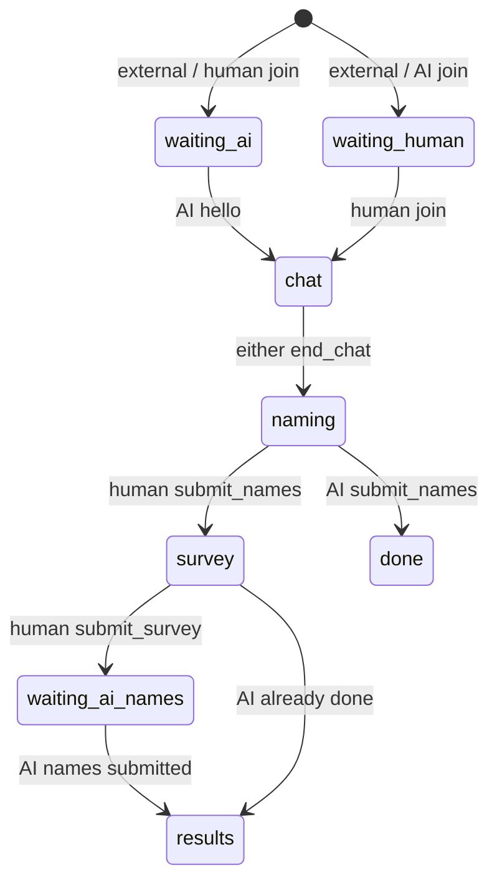

# エージェント接続プロトコル（DEMO）

## 接続

- 外部エージェント用ルームを `POST /api/rooms` に `{ "mode": "external" }` で作成する。応答の `agentToken` は研究者コンソールに一度だけ表示し、人間参加者 URL に含めない。
- 人間: `GET /api/rooms/{roomId}/ws`。エージェント: `GET /api/agent/rooms/{roomId}/ws`。どちらも WebSocket 接続後、`{"type":"hello","protocol":2,"token":"…"}` を送る。エージェントは任意で `agent` ラベルを加えられる。
- 参加者 URL は hash に human token を保持する。human token は agent port で拒否され、agent token は human port で拒否される。保存するのは SHA-256 hash のみ。
- 推奨: `DG_AGENT_TOKEN` 環境変数で token を渡す。コマンドライン引数はシェル履歴やプロセス一覧に残る可能性がある。Node 22 以上、依存なしのスタブ: `node agent/stub-agent.mjs --base https://host --room ID --name stub --once`。

## メッセージと状態

サーバーイベント: `snapshot`, `chat`, `partner_typing`, `error`, `replaced`, `deleted`, `pong`。クライアント: `hello`, `chat` (`clientId` 付き), `typing`, `end_chat`, `submit_names`, `ping`。human 専用: `submit_survey`, `use_mock`, `delete_room`。AI は survey、モード切替、削除を送れない。

mock mode は人間 join と同時に chat を開始する。外部 AI が一度も接続しておらず、人間が `waiting_ai` の間だけ `use_mock` で切替可能。

## アクセス境界

| 情報 | 人間 | 外部AI |
|---|---|---|
| AI token | 不可 | 自身が保持 |
| AI の figure 順/slot | 不可 | 可（自身の snapshot） |
| AI judgement | 現在は存在しない | 現在は存在しない |
| 会話履歴 | 可 | 可 |
| 人間の名前 | 自身の確定名のみ | 不可 |
| 人間の survey | 可 | 不可 |
| 比較結果 | survey 提出後の results で可 | 送信しない |

human snapshot に刺激ID、set/seed、AI slot/order、token/hash、mode 内部情報を含めない。agent snapshot に人間の名前と survey は含めない。結果は human phase が `results` になった後だけ公開する。

## 模擬AIと将来の接続

模擬AIは図形を見ず、認識もしない単純な文字列ルールです。会話の応答と名前の照合を動かすためのデモであり、研究結果には使えません。名前提出時の番号→刺激対応にはサーバー内の oracle を使います。これはデモ完走専用で、grounding や知覚を意味しません。

将来のマルチモーダル接続口は `worker/partners/types.ts` の `PartnerAdapter` です。`PartnerTurnInput` は AI order の opaque slot 付き figures、会話履歴、公開 stage cue を受けます。将来 VLM が `PartnerJudgement.checkNow` と応答を返す形を想定しています。現在は実装も外部モデル API 呼出しもありません。

## 制限と削除

ルーム寿命は作成時刻から30日、DO alarm で全データを削除します。人間は任意フェーズで `delete_room` を送って即時削除できます。最大 frame 8 KiB、発話300文字、ルーム400発話、各席10秒あたり8発話、作成元 IP あたり毎分10ルームです。human 接続は同一 Origin のみ（Origin 欠落は許容）、agent 接続は Origin 欠落を許容し、ある場合は同一 host のみです。
